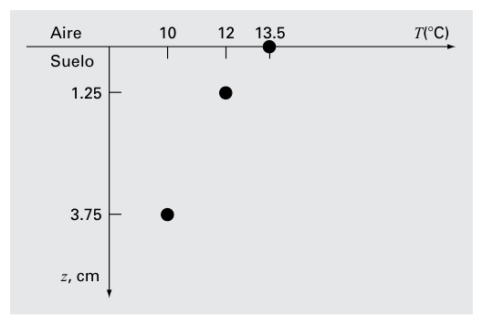
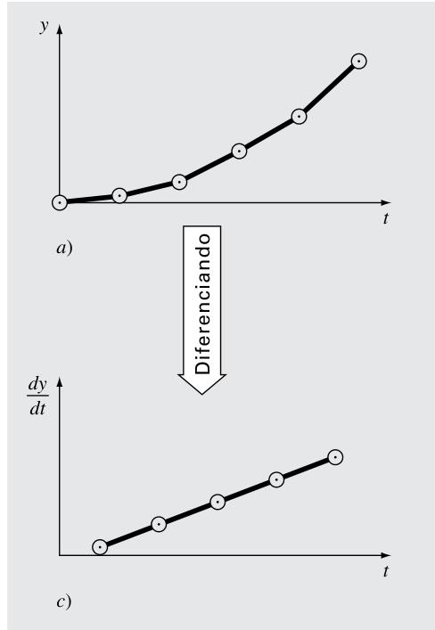
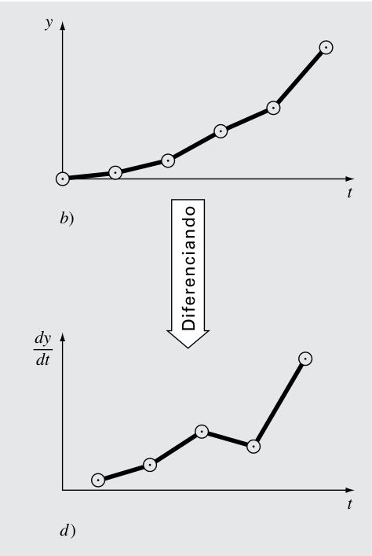

# 1 · Derivación numérica

Guía del [cuaderno 01](../../notebooks/U5_01_Derivacion_Numerica.ipynb). Lo que
se decide aquí: **de qué lado del punto tomo la muestra** y **cuánto separo una
muestra de otra**.

## Las tres diferencias y su error

$$
f'(x_i) \approx \frac{f(x_{i+1}) - f(x_i)}{h}
\qquad\text{adelante, error } O(h)
$$

$$
f'(x_i) \approx \frac{f(x_i) - f(x_{i-1})}{h}
\qquad\text{atrás, error } O(h)
$$

$$
f'(x_i) \approx \frac{f(x_{i+1}) - f(x_{i-1})}{2h}
\qquad\text{centrada, error } O(h^2)
$$

La centrada gana un orden gratis: usa los mismos dos valores, solo que uno a
cada lado. Su precio es que hay que esperar la muestra siguiente y que en el
primer y el último punto de la señal no se puede aplicar.

Con espaciado irregular, la fórmula se generaliza dividiendo entre el intervalo
real (ecuación 23.9 del libro):

$$
f'(x_i) \approx \frac{y_i - y_{i-1}}{t_i - t_{i-1}}
$$

## Figura 23.4 · tres puntos desiguales



El libro mide 13.5, 12 y 10 °C a 0, 1.25 y 3.75 cm de profundidad. La
temperatura baja al profundizar y los tres puntos **no** están igualmente
espaciados: es el caso normal, porque los instrumentos no muestrean parejo.

## Figura 23.5 · por qué el ruido es el enemigo

La figura viene partida en dos mitades. Primero los datos limpios y su derivada:



Y después los mismos datos con un error mínimo, y su derivada:



Arriba están los datos, abajo su derivada. Con los datos limpios la derivada
sale suave; con un cambio mínimo en un solo valor, la derivada se vuelve un
zigzag. El método de diferencias no distingue una variación real de un error de
medición.

## Qué método, en Python y en MATLAB

| Método | En Python | En MATLAB | Cuándo usarlo | Cuándo no |
|---|---|---|---|---|
| Hacia atrás | `(y[1:]-y[:-1])/dt` | `diff(y)./diff(t)` | Lazo de tiempo real: solo hay pasado | Si puedes esperar una muestra, la centrada cuesta lo mismo y gana un orden |
| Centrada | `np.gradient(y, t)` | `gradient(y, t)` | Fuera de línea, o en línea con un retardo de una muestra | En los extremos de la señal: falta un vecino |
| Adelantada | `(y[1:]-y[:-1])/dt` desplazado | `diff(y)./diff(t)` | Sistemas predictivos que necesitan el valor futuro | Casi nunca: no es causal y no gana precisión |
| Segunda derivada | `np.gradient(np.gradient(y, t), t)` | `gradient(gradient(y, t), t)` | Aceleración a partir de posición | Sin filtrar antes: el ruido crece como el inverso del cuadrado del paso |
| Richardson | a mano, con dos mallas | a mano, con dos mallas | Más orden con la misma malla y datos limpios | Con ruido: lo amplifica |

```python
import numpy as np
np.diff(y)                                   # diferencias, sin dividir entre dt
np.gradient(y, t)                            # centrada; acepta t no uniforme
np.convolve(y, np.ones(7) / 7, mode="same")  # media móvil
from scipy.signal import savgol_filter
savgol_filter(y, window_length=11, polyorder=3)
```

```matlab
diff(y);  gradient(y, t);
filter(ones(1,7)/7, 1, y)          % media móvil
sgolayfilt(y, 3, 11)               % Signal Processing Toolbox
```

## La trampa

El error de truncamiento baja con el paso, pero el ruido **sube**: al reducir el
paso a la mitad, el primero mejora cuatro veces y el segundo empeora dos. Existe
un paso óptimo y, por debajo de él, refinar empeora la estimación. Por eso al
derivar dos veces se filtra primero.
