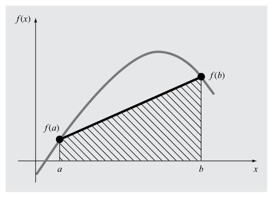
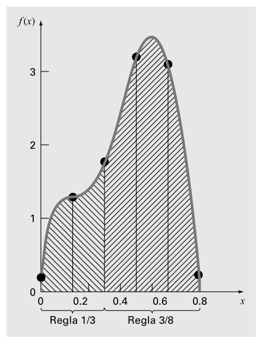

# 2 · Integración numérica

Guía del [cuaderno 02](../../notebooks/U5_02_Integracion_Numerica.ipynb). Lo que
se decide aquí: **tengo la función o solo las muestras**, y **el paso es
uniforme o no**.

## Las fórmulas

Trapecio simple (ecuación 21.3):

$$
I = (b-a)\,\frac{f(a)+f(b)}{2}
$$

Trapecio múltiple (ecuación 21.9), con $h=(b-a)/n$:

$$
I = \frac{h}{2}\left[f(x_0) + 2\sum_{i=1}^{n-1} f(x_i) + f(x_n)\right]
$$

Simpson 1/3 (ecuación 21.14), con $h=(b-a)/2$:

$$
I \cong \frac{h}{3}\left[f(x_0) + 4f(x_1) + f(x_2)\right]
$$

Simpson 3/8 (ecuación 21.20):

$$
I \cong (b-a)\,\frac{f(x_0)+3f(x_1)+3f(x_2)+f(x_3)}{8}
$$

Trapecio con paso irregular (ecuación 21.22):

$$
I = \sum_{i=1}^{n} h_i\,\frac{f(x_{i-1})+f(x_i)}{2}
$$

## Figura 21.4 · qué hace el trapecio



La curva se cambia por la recta que une sus extremos. El área sombreada es el
trapecio que se usa como estimación, y la franja entre la recta y la curva es
exactamente el error que se comete. Si la curva es cóncava, el trapecio
sobreestima; si es convexa, subestima.

## Figura 21.12 · combinar 1/3 con 3/8



La curva es unimodal y asimétrica. El tramo de la izquierda se integra con
Simpson 1/3 y el de la derecha con Simpson 3/8. Es el recurso cuando el número
de intervalos no es par: en lugar de tirar un segmento, se cubre el final con
la regla de tres octavos y todo el intervalo queda integrado con el mismo orden
de error.

## Qué método, en Python y en MATLAB

| Método | En Python | En MATLAB | Cuándo usarlo | Cuándo no |
|---|---|---|---|---|
| Rectángulo izquierda / derecha | suma propia | suma propia | Acumulador dentro de un lazo | Fuera de línea: el trapecio cuesta lo mismo y es mejor |
| Trapecio | `np.trapezoid(y, t)` | `trapz(t, y)` | Datos tabulados, paso irregular, señal suave | Necesitas un orden alto con pocos puntos |
| Trapecio acumulado | `scipy.integrate.cumulative_trapezoid` | `cumtrapz` | Quieres la integral **en cada instante** | Solo te interesa el total: gasta memoria de más |
| Simpson 1/3 | `scipy.integrate.simpson(y, x=t)` | se compone con `trapz` o `integral` | Función suave y número **par** de intervalos | Número impar de intervalos, o datos con ruido |
| Simpson 3/8 | `scipy.integrate.simpson(y, x=t)` sobre 3 segmentos | se compone | Cuando los intervalos son múltiplos de 3 | Como opción por defecto: 1/3 es más simple y del mismo orden |
| Cuadratura adaptativa | `scipy.integrate.quad(f, a, b)` | `integral(f, a, b)` | Tienes la **función** y quieres control del error | Solo tienes muestras, o necesitas el valor en cada instante |

```python
import numpy as np
from scipy import integrate

np.trapezoid(y, t)                              # trapecio (NumPy 2.x; antes np.trapz)
integrate.cumulative_trapezoid(y, t, initial=0) # acumulado
integrate.simpson(y, x=t)                       # Simpson, acepta x no uniforme
integrate.quad(f, a, b)                         # adaptativa: devuelve (valor, error)
```

```matlab
trapz(t, y)
cumtrapz(t, y)
integral(@(x) f(x), a, b)        % adaptativa
quadgk(@(x) f(x), a, b)          % Gauss-Kronrod, para precisión alta
```

En MATLAB no hay una función estándar de Simpson: se resuelve con `integral`
(que es mejor) o componiendo `trapz` sobre un refinamiento.

## Cómo se elige

- **¿Tienes la función o las muestras?** Con función, cuadratura adaptativa. Con
  muestras, trapecio.
- **¿El paso es uniforme?** Si no, trapecio con el ancho de cada intervalo: es
  la única regla de Newton–Cotes que sobrevive sin inventar datos.
- **¿Necesitas el valor en cada instante?** Acumulado, no la integral total.
- **¿Quieres más orden gratis?** Con muestras uniformes, Simpson 1/3 sube de
  $O(h^2)$ a $O(h^4)$ sin evaluar nada nuevo.

## Integrar también filtra el ruido

Es el contraste con la derivación y conviene tenerlo claro:

| Operación | Qué le hace al ruido | Por qué |
|---|---|---|
| Derivar | lo **amplifica**, y mucho | Resta dos muestras vecinas y divide entre un paso pequeño: el ruido entra completo y multiplicado |
| Integrar | lo **atenúa** en términos relativos | Suma muchos valores; las fluctuaciones de un signo se compensan con las del otro |

Con una señal muestreada a 200 Hz y un ruido de $0.05$, la derivada numérica
sale con un error medio unas **150 veces** mayor que el ruido, mientras que la
integral acumulada queda por debajo del propio ruido y al final del intervalo se
aparta apenas unas milésimas del valor exacto.

La razón fina: al integrar, el ruido crece como la raíz del número de muestras,
mientras la señal crece con el número de muestras. El error **relativo** baja
aunque el absoluto suba. La derivación hace lo contrario y, además, no tiene
memoria: cada estimación depende solo de dos muestras.

De ahí dos consecuencias prácticas: en un lazo con sensor ruidoso conviene
integrar antes que derivar, y una señal ruidosa nunca se deriva dos veces sin
filtrar. El libro lo dice en el pie de la figura 23.5: la operación inversa de
la integración tiende a suavizar los errores de los datos.

