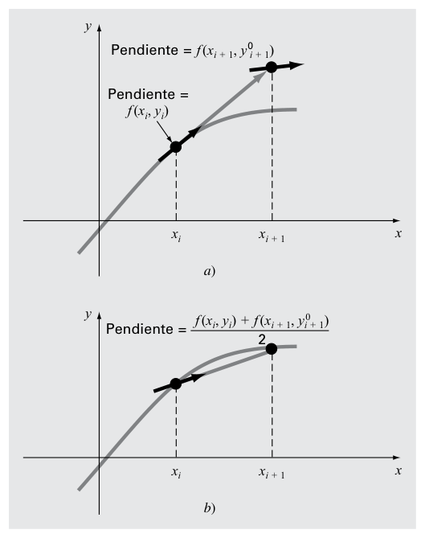
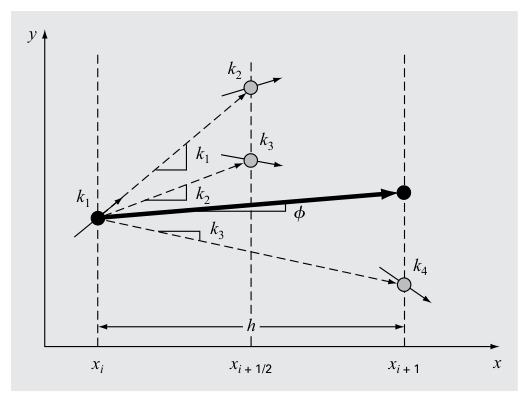

# 3 · EDO de un paso

Guía del [cuaderno 03](../../notebooks/U5_03_EDO_Un_Paso.ipynb). Lo que se
decide aquí: **cuántas evaluaciones de la pendiente puedo pagar por paso** y
**qué orden de error necesito**.

## Las fórmulas

Euler (ecuación 25.2):

$$
y_{i+1} = y_i + f(x_i, y_i)\,h
$$

Heun: predictor (25.15) y corrector (25.16):

$$
y_{i+1}^{0} = y_i + f(x_i,y_i)\,h, \qquad
y_{i+1} = y_i + \frac{f(x_i,y_i) + f(x_{i+1}, y_{i+1}^{0})}{2}\,h
$$

Punto medio (25.25) y (25.27):

$$
y_{i+1} = y_i + f\!\left(x_{i+1/2},\, y_{i+1/2}\right) h
$$

RK4 clásico (25.40):

$$
y_{i+1} = y_i + \frac{1}{6}\left(k_1 + 2k_2 + 2k_3 + k_4\right)h
$$

## Figura 25.9 · Heun, paso a paso



En el panel a) se predice con Euler: se traza la pendiente del punto de partida
hasta el final del intervalo y se evalúa ahí la pendiente otra vez. En el panel
b) la recta definitiva usa el **promedio** de las dos pendientes, la del inicio
y la del predictor. Es un método predictor–corrector: gana un orden con solo dos
evaluaciones de la pendiente por paso.

## Figura 25.15 · RK4, cuatro pendientes



Se calculan cuatro pendientes dentro del mismo paso: $k_1$ al inicio, $k_2$ y
$k_3$ en el punto medio, $k_4$ al final. La recta gruesa es el promedio
ponderado $(k_1 + 2k_2 + 2k_3 + k_4)/6$, y con esa pendiente efectiva se avanza
el paso completo. Cuatro evaluaciones por paso compran un error de orden
cuatro: es el mejor equilibrio entre trabajo y precisión para sistemas no
rígidos.

## Qué método, en Python y en MATLAB

| Método | En Python | En MATLAB | Cuándo usarlo | Cuándo no |
|---|---|---|---|---|
| Euler | a mano en el lazo: `y += f(t, y) * h` | `y = y + f(t,y)*h` | Lazo de control a paso fijo, o para entender qué es un paso | Para reportar un resultado: su error global es de orden uno |
| Heun | a mano; o `solve_ivp(method='RK23')` | `ode23` | Quieres orden dos con dos evaluaciones | Sistema rígido: el paso se encoge hasta el absurdo |
| Punto medio | `solve_ivp(method='RK23')` | `ode23` | Una evaluación más que Euler y un orden más | Si ya vas a pagar cuatro evaluaciones, usa RK4 |
| RK4 | `solve_ivp(method='RK45')` | `ode45` | Opción por defecto para sistemas **no rígidos** | Sistemas rígidos, o integraciones muy largas |
| DOP853 | `solve_ivp(method='DOP853')` | `ode45` con tolerancia ajustada | Tolerancias muy finas | Uso general: cuesta más por paso |
| `odeint` (LSODA) | `scipy.integrate.odeint(f, y0, t)` | `ode15s` automático | Código viejo que ya lo usa; resuelve rígido y no rígido | Código nuevo: `solve_ivp` es la interfaz recomendada |

```python
from scipy.integrate import solve_ivp, odeint

sol = solve_ivp(f, [0.0, 10.0], [y0], method="RK45", t_eval=t, rtol=1e-6)
sol.t, sol.y, sol.nfev, sol.status    # nfev = evaluaciones de f; status 0 = terminó bien

odeint(f, y0, t)                      # interfaz antigua, usa LSODA por dentro
```

```matlab
opciones = odeset('RelTol', 1e-6, 'Stats', 'on');
[t, y] = ode45(@(t, y) f(t, y), [0 10], y0, opciones);
```

## Cómo se elige

- **Un lazo de control** no elige: corre Euler porque es lo que cabe en el
  microcontrolador a paso fijo.
- **Un resultado que se va a reportar** no se da con Euler: con `RK45`/`ode45`
  y una tolerancia declarada.
- **Cada evaluación de la pendiente es carísima** (por ejemplo, si hay que
  resolver un sistema de ecuaciones dentro): conviene un método que reutilice
  pendientes, y eso es el tema del cuaderno 04.
- **El paso se hunde o `status != 0`**: no es un problema de tolerancia, es
  rigidez. También es el tema del cuaderno 04.
