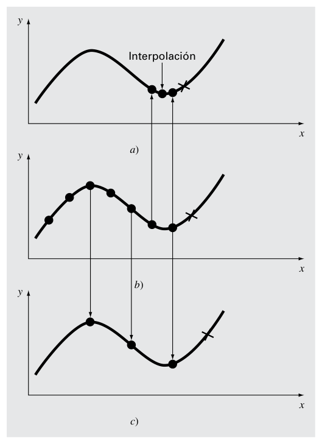

# 4 · EDO multipaso y rigidez

Guía del [cuaderno 04](../../notebooks/U5_04_EDO_Multipaso.ipynb). Aquí no se
programa nada: el ejercicio es **decidir** qué solver usar y demostrarlo con
números.

## Las fórmulas

Adams–Bashforth de cuarto orden, el predictor (26.44):

$$
y_{i+1}^{0} = y_i + h\left(\frac{55}{24}f_i - \frac{59}{24}f_{i-1} + \frac{37}{24}f_{i-2} - \frac{9}{24}f_{i-3}\right)
$$

Adams–Moulton de cuarto orden, el corrector (26.45):

$$
y_{i+1}^{j} = y_i + h\left(\frac{9}{24}f_{i+1}^{j-1} + \frac{19}{24}f_i - \frac{5}{24}f_{i-1} + \frac{1}{24}f_{i-2}\right)
$$

La idea es simple: en lugar de evaluar la pendiente cuatro veces en el paso
actual como RK4, se **reutilizan** las pendientes de los pasos anteriores, que
ya están calculadas.

## Figura 26.6 · cómo trabaja un multipaso



El panel a) muestra el problema del arranque: la fórmula necesita varios puntos
previos, y al principio no existen, así que el primer tramo se obtiene
interpolando o con un método de un paso. El panel b) muestra la solución ya
calculada, y el c) los pocos nodos que hay que conservar para aplicar la
fórmula y predecir el siguiente. Ese es el ahorro: menos evaluaciones por paso,
al precio de arrastrar historia y de tener que arrancar con otro método.

## Qué método, en Python y en MATLAB

| Método | En Python | En MATLAB | Cuándo usarlo | Cuándo no |
|---|---|---|---|---|
| Adams–Bashforth 4 | se programa | se programa | Cada evaluación de la pendiente es carísima | Al arrancar: necesita cuatro puntos previos |
| Adams–Moulton 4 | se programa | se programa | Como corrector del predictor anterior | Solo: es implícito y hay que iterarlo |
| Predictor–corrector con tolerancia | se programa | se programa | Quieres controlar cuántas iteraciones del corrector haces | Implementación rápida: `ode113` ya lo hace |
| Adams de orden variable | `solve_ivp(method='LSODA')` o a mano | `ode113` | Trayectorias largas y suaves, tolerancias exigentes | Sistemas rígidos: el paso se hunde |
| BDF | `solve_ivp(method='BDF')` | `ode15s` | **Sistemas rígidos**: constantes de tiempo muy distintas | Sistemas no rígidos y cortos: más caro que RK45 |
| Radau | `solve_ivp(method='Radau')` | `ode23s`, `ode23tb` | Rigidez fuerte con tolerancias finas | Integraciones cortas y suaves |
| LSODA | `solve_ivp(method='LSODA')` | `ode15s` automático | No sabes si es rígido y no quieres averiguarlo | Cuando quieres control explícito del método |

## Cómo se diagnostica la rigidez

Un sistema es rígido cuando sus escalas de tiempo están muy separadas: el
cociente entre el eigenvalor más grande y el más pequeño de la matriz jacobiana
es enorme. En la práctica se detecta por el **síntoma**, no por el cálculo:

| Síntoma | Qué significa | Qué hacer |
|---|---|---|
| El número de evaluaciones es altísimo sobre una curva que se ve suave | El paso explícito está limitado por estabilidad, no por precisión | Cambiar a un método implícito |
| El paso se encoge casi a cero en un tramo corto | Ahí hay una constante de tiempo rápida | `BDF`, `Radau`, `LSODA` |
| `status != 0` ("step size too small") | El integrador explícito no puede avanzar | Lo mismo que arriba |
| RK45 tarda segundos donde BDF tarda milisegundos | Rigidez confirmada | Reportar las evaluaciones de ambos como evidencia |

```python
sol45 = solve_ivp(f, [0, 1], y0, method="RK45")
solbdf = solve_ivp(f, [0, 1], y0, method="BDF")
print(sol45.nfev, solbdf.nfev)     # si difieren en órdenes de magnitud: es rígido
```

```matlab
s45 = ode45(@f, [0 1], y0, odeset('Stats', 'on'));
s15 = ode15s(@f, [0 1], y0, odeset('Stats', 'on'));
s45.stats.nfev, s15.stats.nfev
```

## Cómo se elige

1. **Primero el diagnóstico:** corre el método explícito y mira cuántas veces
   evaluó la pendiente.
2. **Si el número es razonable**, quédate ahí: los implícitos cuestan más por
   paso.
3. **Si el número explota o el paso se hunde**, cambia a un implícito y vuelve a
   medir. La comparación de los dos números **es** la justificación.
4. **Si no quieres diagnosticar**, `LSODA` decide solo; pero entonces no tienes
   evidencia que reportar.
